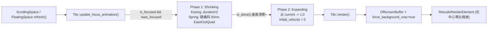
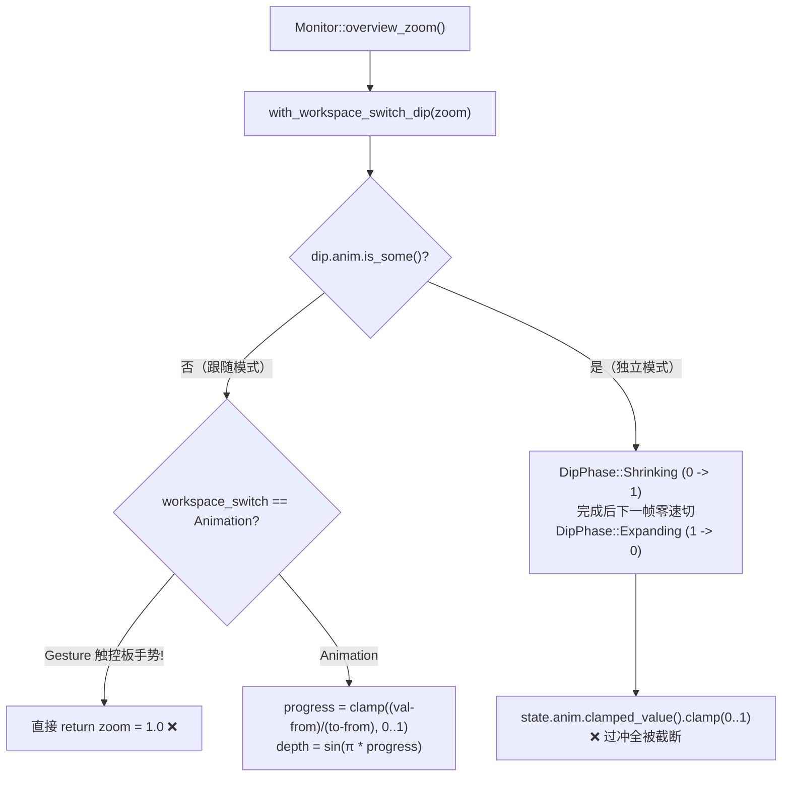
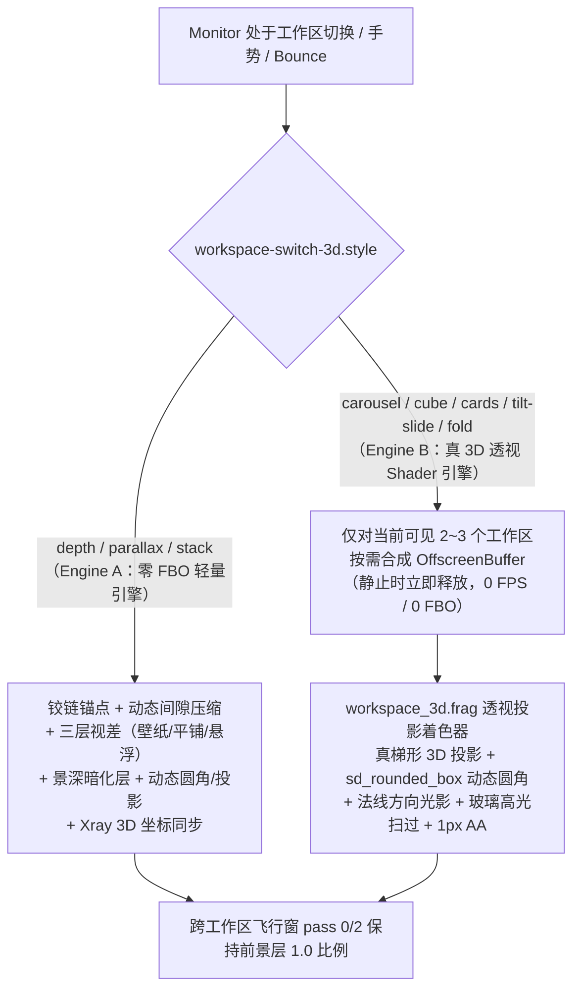

# Niri `focus-animation`、`workspace-dip` 与 `workspace-switch-3d` 深度诊断与全维度优化指导

> **适用分支**：`window-picker`（基于 `upstream/main` `6072f67d` + 本地 Liquid Glass 2.0 / Window Picker 2.0 架构）
> **文档性质**：源码级现状诊断报告 + 动效/视觉/物理/渲染创意方案 + 分阶段工程实施蓝图（本文档阶段**暂不修改代码**）
> **核心目标**：在不破坏 `AI_MERGE_NOTES.md` 7 条合并红线与「静止 0 FPS 零功耗」原则的前提下，全面消除现有动效的卡顿折点、渲染穿帮与配置缺陷，将聚焦动画与工作区切换动效升级至电影级丝滑手感。

---

## 目录

1. [全局诊断总览：源码级问题清单](#1-全局诊断总览源码级问题清单)
2. [Part 1：`focus-animation` 聚焦窗口动画深度分析与优化设计](#2-part-1focus-animation-聚焦窗口动画深度分析与优化设计)
3. [Part 2：`workspace-dip` 工作区缩放下探深度分析与优化设计](#3-part-2workspace-dip-工作区缩放下探深度分析与优化设计)
4. [Part 3：`workspace-switch-3d` 3D 工作区切换深度分析与优化设计](#4-part-3workspace-switch-3d-3d-工作区切换深度分析与优化设计)
5. [Part 4：多动效协同设计（含 Liquid Glass / Bounce 联动与推荐预设）](#5-part-4多动效协同设计含-liquid-glass--bounce-联动与推荐预设)
6. [Part 5：分阶段工程实施指南与逐文件改动蓝图](#6-part-5分阶段工程实施指南与逐文件改动蓝图)
7. [Part 6：不变量守护、性能约束与验收测试清单](#7-part-6不变量守护性能约束与验收测试清单)

---

## 1. 全局诊断总览：源码级问题清单

通过逐行审计 `niri-config/src/appearance.rs`、`src/layout/tile.rs`、`src/layout/scrolling.rs`、`src/layout/floating.rs`、`src/layout/monitor.rs`、`src/niri.rs`、`src/animation/mod.rs`、`src/animation/spring.rs` 与 `src/render_helpers/xray.rs`，汇总三大模块的 **18 项真实源码缺陷与架构瓶颈**：

| 模块 | 严重度 | 问题摘要 | 源码位置 |
| --- | :---: | --- | --- |
| **focus-animation** | 🔴 高 | Spring 模式第一段硬编码 `50ms EaseOutQuad`，转入第二段 Spring 时速度归零且丢失越帧余时，造成峰底明显顿挫 | `src/layout/tile.rs:784-813, 893-902` |
| **focus-animation** | 🔴 高 | `force_background_xray = true` 导致非 XRay 实时磨砂/液态玻璃窗口在聚焦缩放 0.3s 内背景突变为纯壁纸、结束后再闪回底层窗口 | `src/layout/tile.rs:1674-1681` |
| **focus-animation** | 🟠 中 | `FocusScalePart` 存在 3 个已解析但被丢弃的「僵尸字段」：`glow`、`directional`、`no_directional` | `niri-config/src/appearance.rs:2048-2053` |
| **focus-animation** | 🟠 中 | `curve "cubic-bezier"` 参数不足时直接 `.unwrap()` panic；`spring` 与 `duration-ms` 同时写时 `duration-ms` 被静默吞掉 | `niri-config/src/appearance.rs:2150-2184` |
| **focus-animation** | 🟠 中 | 与 `open_animation` 互斥竞争（`Tile::new` 初始化 `was_focused: false`），打开动画短于聚焦动画时会突然跳进半截缩放 | `src/layout/tile.rs:251, 1619-1671` |
| **focus-animation** | 🟠 中 | `is_solo_window` 仅统计各自空间（平铺和悬浮互不知情），1 平铺 + 1 悬浮时双方均误判为 solo | `src/layout/scrolling.rs:3723-3726`、`floating.rs:1185-1187` |
| **focus-animation** | 🟡 低 | 缺少全屏/最大化/跨工作区切换豁免；右键弹出菜单被一起打进 `OffscreenBuffer` 变形缩放；焦点快速切走后旧窗仍在后台大幅弹跳 | `src/layout/tile.rs:865-918, 1350-1357` |
| **workspace-dip** | 🔴 高 | 独立计时模式两段交接速度归零 + 帧对齐漂移停顿；`Spring` 模式下总时长翻倍且 `clamped_value()` + `.clamp(0,1)` 彻底阉割回弹过冲 | `src/layout/monitor.rs:1493, 1512, 1584-1647` |
| **workspace-dip** | 🔴 高 | 跟随模式仅监听 `WorkspaceSwitch::Animation`，**触控板手势（`Gesture`）全程无响应**，松手瞬间从 `1.0` 猛然下沉割裂感极强 | `src/layout/monitor.rs:1498-1510` |
| **workspace-dip** | 🟠 中 | `fullscreen_window_above_top_layer`、`crop_bounds`、`are_transitions_ongoing`、`window_under` 全部漏判 `workspace_dip.is_some()` | `src/layout/monitor.rs:1176, 1844, 1917, 2020` |
| **workspace-dip** | 🟠 中 | `sin(π * progress)` 叠加高刚度 Spring 切换曲线导致前 80ms 急坠、后 250ms 拖尾，且 Spring 过冲回摆时会触发第二次伪下探 | `src/layout/monitor.rs:1508-1509` |
| **workspace-dip** | 🟡 低 | 缩小时四边保持 90° 硬直角且无工作区阴影（`render_workspace_shadows` 锁死在 `overview`）；尾声阶段多重整像素 round 导致 1px 阶梯抖动 | `src/layout/monitor.rs:1453-1463, 1753-1774, 2106` |
| **workspace-switch-3d** | 🔴 高 | **`Xray` 液态玻璃坐标严重错位**：`xray.workspaces` 与 `XrayPos` 未纳入 `workspace_3d_scale`，切换时玻璃窗口内折射背景与真实壁纸脱节滑移 | `src/layout/monitor.rs:2047`、`src/niri.rs:4758-4763, 5113-5133` |
| **workspace-switch-3d** | 🔴 高 | 本质只是纯 2D 轴对齐等宽压扁（无近大远小梯形透视），且以各自工作区中心为锚点缩放导致上下工作区之间撕裂出巨大黑带 | `src/layout/monitor.rs:1522-1554, 1988-1990` |
| **workspace-switch-3d** | 🟠 中 | `MovingBetweenWorkspaces`（跨工作区拖拽/移动的窗口，pass 0/2）也被无差别压扁变形，缺乏前景层豁免 | `src/layout/monitor.rs:1998-2045` |
| **workspace-switch-3d** | 🟠 中 | 缺乏景深暗化（Depth Dimming）、远景衰减、分层视差（壁纸/平铺/悬浮同深度），空间层次感偏薄 | `src/niri.rs:5111-5137`、`src/layout/monitor.rs:2032-2097` |
| **workspace-switch-3d** | 🟡 低 | 未渲染工作区投影与动态圆角；与 `workspace-bounce`（硬编码 280ms/26px 橡皮筋）无 3D 联动 | `src/layout/monitor.rs:543-565, 2101-2133` |
| **Animation 基础层** | 🟠 中 | `Spring::duration()` 在 `from == to && initial_velocity != 0` 时直接返回 `Duration::ZERO`，阻塞了真正的「单段冲量弹簧」实现 | `src/animation/spring.rs:57-59` |

---

## 2. Part 1：`focus-animation` 聚焦窗口动画深度分析与优化设计

### 2.1 现有实现深度剖析

当前 `focus-animation` 的执行管线如下：



#### 核心痛点深挖

1. **为什么现在 `mix.kdl` 里设了 `spring damping-ratio=0.5 stiffness=1400` 依然觉得有点“生硬/抽一下”？**
   - 第一段收缩不是弹簧，也不是平滑蓄力，而是硬编码的 `50ms EaseOutQuad`（`tile.rs:893-901`）。`EaseOutQuad` 在到达 `t = 50ms` 时的导数恰好降到 `0`！
   - 当帧时钟到达 `54ms` 时，`advance_focus_animation()` 发现第一段结束，才在 `54ms` 以 `initial_velocity = 0` 新建第二段 `Spring(0.75 -> 1.0)`。
   - **运动学曲线出现明显的斜率折点 + 4~16ms 谷底死停**，人眼在 120Hz/144Hz 屏幕上非常容易察觉到“先卡一下、再弹回来”的两截感。
2. **为什么单一等比缩放（`0.75 -> 1.0`）显得单调甚至略微眩晕？**
   - 窗口面积在 `0.75` 时瞬间缩小到原来的 `56%`（$0.75^2$），文字整体大幅模糊再恢复锐利；
   - 它缺少**方向上下文**（从左切过来 vs 从右切过来 vs 从上切下来，动作完全一样）、缺少**触觉回馈**（没有弹性面积守恒、没有 3D 轻按感、没有边缘光脉冲）、也与你配置的 `match is-active=false { opacity 0.7 }`（瞬切）和 `liquid-glass { focus-shimmer 2 }`（硬编码 280ms）完全各自为战。
3. **非 XRay 液态玻璃窗口闪烁根因**：
   - `Tile::render()` 在播放 `scale_animation` 时传 `force_background_xray = true`（`tile.rs:1679`），原因是在 `OffscreenBuffer` 里 `FramebufferEffect` 采不到底层桌面。但如果该窗口下方叠着别的窗口（如悬浮窗或半透明层），聚焦动画那 250ms 内窗口背景会**突然跳成纯壁纸**，动画结束那一帧又**突然跳回底层窗口**。

---

### 2.2 全维度优化与创意方案

我们将 `focus-animation` 从单一的「两段缩放」升级为**模块化多通道聚焦动效系统**，每个维度均可独立开关和组合。

#### 维度一：物理引擎革命 ——「单段解析冲量弹簧（Impulse Spring）」

摒弃生硬的「硬编码 50ms + 零速换相」，引入**单段物理冲量模式**（默认推荐）：在 $t=0$ 时刻，把窗口视作静止在平衡点 $s = 1.0$ 的弹簧质点，给它施加一记精准的瞬时速度冲量 $v_0$，让它自然下探（或鼓起）到用户指定的精确峰值 `flash-scale`，再靠真实弹簧力学无缝回弹归位！

**精确数学推导（保证峰值严格等于 `flash-scale`）**：

设位移偏移 $x(t) = s(t) - 1.0$，初值 $x(0) = 0, \dot{x}(0) = v_0$，固有频率 $\omega_0 = \sqrt{k}$，阻尼衰减率 $\beta = \zeta \omega_0$（$\zeta$ 为 `damping-ratio`）：

- **欠阻尼（$0 < \zeta < 1$，有弹性过冲回弹）**：设 $\omega_1 = \sqrt{\omega_0^2 - \beta^2}$，
  $$x(t) = \frac{v_0}{\omega_1} e^{-\beta t} \sin(\omega_1 t)$$
  令 $\dot{x}(t) = 0$ 得首峰时刻 $t_{\text{peak}} = \frac{\arctan(\omega_1 / \beta)}{\omega_1}$，首峰位移 $x(t_{\text{peak}}) = \frac{v_0}{\omega_0} e^{-\frac{\beta}{\omega_1}\arctan(\omega_1/\beta)}$。
  因此反解精确初速度：
  $$v_0 = (s_{\text{flash}} - 1.0) \cdot \omega_0 \cdot \exp\!\left(\frac{\beta}{\omega_1} \arctan\!\left(\frac{\omega_1}{\beta}\right)\right)$$
- **临界阻尼（$\zeta = 1$，丝滑无过冲回弹）**：
  $$x(t) = v_0 t e^{-\omega_0 t},\quad t_{\text{peak}} = \frac{1}{\omega_0},\quad v_0 = (s_{\text{flash}} - 1.0) \cdot e \cdot \omega_0$$
- **过阻尼（$\zeta > 1$，沉稳厚重）**：设 $\omega_2 = \sqrt{\beta^2 - \omega_0^2}$，
  $$x(t) = \frac{v_0}{\omega_2} e^{-\beta t} \sinh(\omega_2 t),\quad t_{\text{peak}} = \frac{\operatorname{artanh}(\omega_2 / \beta)}{\omega_2},\quad v_0 = \frac{(s_{\text{flash}} - 1.0) \cdot \omega_2}{e^{-\beta t_{\text{peak}}} \sinh(\omega_2 t_{\text{peak}})}$$

> **效果对比**：
> - 旧版两段式：折线感、谷底死停 1~2 帧、快切焦点时速度归零跳变。
> - 新版单段冲量：$C^\infty$ 无穷阶光滑，起步迅猛（$t=0$ 就有最大响应速度，按键零延迟感！），谷底自然圆润转身，回弹过冲浑然天成；同时配合 `Animation::with_duration`，用户写 `duration-ms 280` + `spring ...` 时可以**既保留弹性形状又精确控制总完成时间**！
> - 同时保留 `mode "two-phase"` 兼容模式，并在两段交接处传递时间余量与非零速度，让喜欢「先蓄力再弹出」的用户也丝滑无断层。

#### 维度二：超越等比缩放 —— 多形态形变与 3D 触觉反馈

仅做等比缩放很容易让字号忽大忽小、显得生硬。建议新增 5 种现代形变与运动通道（可通过 `style` 一键切换，也可细分参数混搭）：

1. **果冻挤压拉伸（`jelly` / Squash & Stretch）**
   - 原理：动画黄金十二法则之「体积/面积守恒」。当横向缩到 $s_x = 1 + \Delta$ 时，纵向反相微拉 $s_y = 1 - \alpha \cdot \Delta$（默认耦合系数 $\alpha \in [0.35, 0.65]$），例如按压时瞬间变宽变扁一点，弹起时变高变窄一点，最后归回 `(1.0, 1.0)`。
   - 效果：哪怕只给很克制的幅度（`0.95`），视觉活力也远胜纯等比缩到 `0.75`，而且**不会让文字整体变小一圈导致阅读失焦**！
2. **方向感知动量微推（`directional` / Nudge —— 复活僵尸字段！）**
   - 原理：在 `ScrollingSpace` / `FloatingSpace` 切换焦点时记录**旧焦点中心 -> 新焦点中心**的单位方向向量 $\vec{d} = (d_x, d_y)$（键盘方向切换直接知晓方向，鼠标/Picker 切换用两窗中心向量）。
   - 动作：新获焦窗口沿 $\vec{d}$ 方向获得一个 8~16px 的**物理冲量微推**（先顺势探出一点再弹回原位），仿佛视线撞过去之后把窗口轻推了一下，视觉引导极强！
   - 配合横向滚动视图（Niri 标志性的无限横向卷轴）时，水平切换焦点瞬间带有自然的惯性跟随感。
3. **3D 触觉按压与迎面偏转（`tilt` / 3D Press & Swivel）**
   - 原理：利用轻量化 `tile_focus.frag` 透视着色器（复用我们在 `picker_card.frag` 验证成熟的 1px AA 透视投影）：
     - **键盘方向切入**：从左侧切入时，窗口绕 Y 轴顺势微偏 `3°~6°` 再弹性回正（像翻开一页玻璃卡片迎向你）；从上方切入绕 X 轴轻点头；
     - **鼠标点击切入**：读取指针在窗口内的相对坐标 `(nx, ny) ∈ [-1, 1]²`，以点击侧下沉实现**真实 3D 按钮按压回弹（Tap Tilt）**！点窗口左上角就左上角下沉、右下角翘起，像按在 Apple VisionOS 玻璃面板上一样真实！
4. **悬浮抬升（`lift` / Elevation + 动态阴影）**
   - 获焦瞬间窗口垂直微浮 `-6px -> 0`（或配合聚焦态常驻微抬升），同步驱动 `Tile::shadow` 的 `softness` / `spread` / `offset_y` 做平滑放大再收敛，给窗口“浮起来被拿起”的物理重量感。
5. **失焦反向微退让（`unfocus` 可选通道）**
   - 当焦点离开旧窗口时，如果旧窗口正在播放聚焦动画，**立即无缝中断并带着当前速度温柔归位**（避免焦点已走旧窗还在狂跳）；
   - 可选开启极轻微的失焦下沉（例如 `unfocus-scale 0.985`，用柔和冲量轻退一下归位，或在失焦期间保持极细微的常驻景深差 `inactive-scale 0.985`——需注意平铺排版视觉间距）。

#### 维度三：光影、材质与透明度平滑联动（与 `mix.kdl` 绝配）

你当前的 `mix.kdl` 里同时配置了：
- `window-rule { match is-active=false; opacity 0.7 }`
- `liquid-glass { focus-shimmer 2 }`
- `focus-ring { off }` / `border { off }`

以下 3 项光影通道与你的配置天然互补：

1. **焦点边缘脉冲辉光（`glow` —— 复活僵尸字段！）**
   - 获焦时沿窗口圆角外边缘迸发一圈可配置颜色、扩散宽度、强度的脉冲光晕（类似 Window Picker 的选中光晕），也可支持「外扩涟漪（`ripple`）」形态：光环从窗口边界向外扩散 `18px` 并同步淡出，极简、高级、完全不遮挡文字！
   - 当 `focus-ring` 关闭时，这种转瞬即逝的边缘光效就是最优雅的焦点指示器。
2. **窗口激活亮度微闪 + 非焦点平滑过渡（`brightness-pulse` & `opacity-transition`）**
   - **亮度微闪**：在获焦瞬间给窗口表面叠加一个极克制的亮度增益（`+0.06 ~ +0.12`，类似高刷 OLED 唤醒感），180ms 内平滑衰减回 `1.0`；
   - **Opacity 平滑插值**：目前 `window-rule` 的 `is-active=false { opacity 0.7 }` 切换焦点时是 **0ms 硬瞬切**！在 `Tile` 上给 `rules.opacity` 增加一个轻量的 `opacity_transition`（可复用 `focus-animation` 时长或独立 `opacity-transition-ms`），焦点切换时旧窗柔和沉入 `0.7`、新窗丝滑亮起至 `1.0`，观感高级感直接拉满！
3. **打通 Liquid Glass `focus-shimmer` 扫光联动**
   - 不再把 `tile.rs:857` 的 `glass_shimmer_animation` 写死为 `280ms` 单向 `EaseOutCubic`：
     - 支持在 `focus-animation` 中配置 `shimmer-duration-ms` 或默认与主聚焦动画同步；
     - 将焦点切换方向向量传给 `glass_background.frag`，让玻璃斜扫光**顺着切换方向扫过整个窗口**（从左切入就从左往右扫光，从右切入就从右往左扫光）！

#### 维度四：渲染架构升级 —— 彻底根治 XRay 闪烁与弹窗变形

1. **分离 Popups**：在 `Tile::render` 的 `scale_animation` 分支中，将 `window.render_popups` 从 `OffscreenBuffer` 中拆出，直接按当前缩放/偏移后的锚点叠加在顶层，避免右键菜单/输入法候选框跟着被压缩模糊。
2. **零闪烁实时透视玻璃背景（解决非 XRay 玻璃跳变）**：
   - 当窗口使用 `background-effect` 且用户**未开启 `xray true`** 时：
     - 路线 A（最佳画质）：跳过把 `BackgroundEffect` 放进 `OffscreenBuffer`，而是直接在 `Tile::render` 中紧贴在 `tile_focus` 元素下方调用类似我们在 Window Picker 实现的 `FramebufferEffect::render_perspective`（透视同步实时模糊+玻璃折射），窗口主体（无背景特效）进 `OffscreenBuffer` 套 `tile_focus.frag`！这样**缩放、果冻、3D Tilt 时底层窗口实时可见，完全不跳变回纯壁纸**！
     - 路线 B（安全兼容）：保留 `AI_MERGE_NOTES.md` 的 `force_background_xray` 作为无透视 Shader 或降级场景下的安全网，不破坏既有 7 条不变量。
3. **按需启用 Offscreen（极致轻量化）**：
   - 若用户只启用了 `directional`（纯位移）+ `glow`（外发光）+ `lift`（动态阴影）而关闭了 `scale`/`jelly`/`tilt`，则**完全不需要创建 `OffscreenBuffer`**！直接零 FBO 渲染，4K 144Hz 零显存带宽开销！

#### 维度五：精细化触发语义与场景保护

1. **修复 `is_solo_window`**：在 `Workspace::refresh()` 中统一统计 `self.scrolling.tiles().count() + self.floating.tiles().count() <= 1`，再分别传给 `scrolling.refresh()` 和 `floating.refresh()`。
2. **新增完整保护开关**：
   - `disable-on-open`（默认 `true`）：新开窗口首次获焦已有 `open_animation`，不再叠加聚焦缩放，消除跳帧；
   - `disable-on-fullscreen`（默认 `true`）：全屏视频/游戏切回时不缩进黑边；
   - `disable-on-maximized`（默认 `false`）：最大化窗口可选抑制或自动衰减幅度（如自动乘以 `0.4`）；
   - `disable-on-workspace-switch`（默认 `false`，或 `workspace-switch-delay-ms`）：工作区切完瞬间避免与 `workspace-dip` / `workspace-switch-3d` 双重叠加发晕；
   - `debounce-ms`（默认 `40`）：键盘快速连按跳过中间窗口时，短暂停留的窗口不触发剧烈形变，只对最终落点生效！
3. **支持 `window-rule` 级覆写**：允许特定应用关闭或定制专属聚焦动画（例如浏览器轻盈微推、终端果冻弹跳、视频播放器/锁屏工具 `off`）。

---

### 2.3 建议的 `focus-animation` 配置 Schema（向后完全兼容）

```kdl
layout {
    focus-animation {
        on

        // 驱动模式：
        // - "impulse"（推荐默认）：单段解析冲量弹簧，零顿挫、零速度断层、精确命中 flash-scale
        // - "two-phase"：经典先缩后弹两段式（支持独立配置入场曲线与出场弹簧）
        mode "impulse"

        // 预设风格（一键设置推荐组合，下方单项可继续覆写）：
        // "pulse"（经典脉冲）| "jelly"（果冻面积守恒）| "tilt"（3D触觉按压）| "nudge"（方向微推）| "glow"（极简纯光效）
        // preset "jelly"

        // 物理曲线：支持 spring 与 duration-ms 同时使用！（保留弹簧回弹形态，同时精确控制总完成时长）
        spring damping-ratio=0.55 stiffness=900 epsilon=0.0001
        // duration-ms 240
        // curve "ease-out-cubic"

        // （仅 two-phase 模式可选）单独指定收缩/入场段时长与曲线
        // in-duration-ms 55
        // in-curve "ease-out-quad"

        // 触发边界控制
        disable-on-solo false
        disable-on-floating true
        disable-on-fullscreen true
        disable-on-maximized false
        disable-on-open true
        disable-on-workspace-switch false
        // 连续快速切焦点防抖（ms）
        debounce-ms 35

        // 通道 1：缩放 / 果冻形变（完全兼容现有 scale {} 语法）
        scale {
            on
            flash-scale 0.94          // 1.0 正常，<1.0 下压回弹，>1.0 鼓起回弹
            jelly 0.45                // 0=纯等比缩放；0.3~0.65=面积守恒果冻挤压拉伸
            // 保留旧字段兼容：disable-on-solo / disable-on-floating
        }

        // 通道 2：方向感知动量微推（复活 directional）
        nudge {
            on
            distance 12.0             // 最大推动逻辑像素（沿焦点切换方向）
        }

        // 通道 3：3D 微倾斜/点击按压（启用专用 tile_focus.frag，1px AA）
        tilt {
            on
            angle 3.5                 // 最大偏转角度（度，范围 0..20）
            pointer-press true        // 鼠标点击获焦时按点击位置产生真实 3D 按压倾角
        }

        // 通道 4：边缘辉光 / 外扩涟漪脉冲（复活 glow）
        glow {
            on
            style "ripple"            // "pulse"（贴边发光）| "ripple"（向外扩散淡出光环）
            color "#31f6b9cc"
            spread 16.0               // 扩散半径（px）
            strength 0.85             // 0..2
        }

        // 通道 5：光影与非焦点平滑过渡
        brightness-pulse 0.08         // 获焦瞬间亮度微提（0..0.5）
        opacity-transition-ms 180     // 窗口 rule opacity（如 0.7 <-> 1.0）平滑过渡时长（0=瞬切）
        lift 4.0                      // 获焦微抬升（px）+ 动态阴影联动
    }
}

// 同时支持 window-rule 级精细覆写：
window-rule {
    match app-id="mpv"
    focus-animation {
        off
    }
}
```

---

## 3. Part 2：`workspace-dip` 工作区缩放下探深度分析与优化设计

### 3.1 现有实现深度剖析

当前 `workspace-dip` 的控制流在 `src/layout/monitor.rs`：



#### 5 个直接损害“丝滑度”的源码级根因

1. **触控板手势完全断档（`monitor.rs:1498`）**
   - 当用户用三指/四指在触控板上下滑动切工作区时，`workspace_switch` 是 `WorkspaceSwitch::Gesture`，`with_workspace_switch_dip` 直接返回未缩放的 `zoom = 1.0`。
   - 一旦松手进入 `workspace_switch_gesture_end`，`workspace_switch` 突然变为 `Animation` 并立即调用 `start_workspace_dip()`（`monitor.rs:2376`），此时手势可能已经滑到 `0.65` 了：
     - 跟随模式下，`sin(π * 0)` 从 0 开始，手势滑完 65% 后松手反而凭空下沉再弹回；
     - 独立模式下，松手后才开始走完整两段下探，跟手指运动完全脱节！
2. **默认 `sin(π * progress)` 与 Spring 切换曲线失配 + 过冲二次下沉**
   - Niri 默认 `workspace_switch` 是 `Spring(damping=1.0, stiffness=1000)`：它在前 30% 时间就冲完 75% 的位移，后 70% 时间都在缓慢收敛。
   - 因此 `sin(π * progress)` 看起来会**瞬间猛砸到底（前 60ms），然后极慢地爬回 1.0**；
   - 如果用户把 `workspace_switch` 改成了欠阻尼弹簧（如 `damping=0.7`），工作区过冲到 `1.08` 时 `progress` 被 clamp 在 `1.0`（`depth = 0`），而弹簧往回摆经过 `0.98` 时 `progress = 0.98` 导致 `sin(0.98π) > 0`，工作区会**在落定后莫名再抖缩一小下**！
3. **独立计时模式的速度死点 & 弹簧过冲被阉割**
   - `monitor.rs:1584-1647`：两段各自用完整 `Spring`，不仅总时长变成两倍，还因为 `clamped_value().clamp(0., 1.)` 把弹簧原本最迷人的轻微过冲回弹（例如从 `0.94` 弹到 `1.006` 再轻落回 `1.0`）全部一刀切死！
   - 而且从 `Shrinking` 到 `Expanding` 的帧越界时间丢失（你甚至可以在现有单元测试 `src/layout/tests/animations.rs:105-110` 里直接看到这个问题：总时长 1000ms 的测试必须推进到 1125ms 才能测到 Expanding 25%！）。
4. **连续切换工作区抽搐（无巡航保持）**
   - 当你在 4 个工作区之间连续快速敲击 `Mod+Down` 三次，每次按键都调用 `start_workspace_dip()` 从当前深度零速重新起跳，镜头像打嗝一样一抖一抖，而不是优雅地停留在微缩视野中顺畅滑过所有工作区，最后一次落定时才放大归位。
5. **边界渲染与坐标隐患**
   - `monitor.rs:1917`：`fullscreen_window_above_top_layer()` 没检查 `self.workspace_dip.is_some()` → 独立 dip 长于 switch 时全屏窗提前弹出顶栏之上跳变；
   - `monitor.rs:2020`：`crop_bounds` 没检查 `self.workspace_dip.is_some()` → 独立 dip 尾声裁剪提前撤销；
   - `monitor.rs:1176`：`are_transitions_ongoing()` 没检查 `self.workspace_dip.is_some()`；
   - `monitor.rs:1844`：`window_under()` 仅在 `overview_progress.is_some()` 时按 `zoom` 反算指针位置，dip 期间指针点击位置略有偏差；
   - `monitor.rs:1453-1463` + `1753-1774`：`workspace_size(zoom)` 向上取整（`ceil`）叠加 `static_offset` 四舍五入，在 `strength = 0.04` 缓慢回归 `1.0` 的最后 120ms，工作区左右边缘按 1~2 物理像素跳档，高刷屏可见轻微“抖边”。

---

### 3.2 `workspace-dip` 2.0 深度优化与创意升级

#### 升级一：三种更科学的镜头深度驱动模型（`mode`）

1. **`velocity`（速度耦合物理镜头，🔥 强烈推荐为新默认）**
   - **核心思想**：电影摄影机移动得越快，广角拉得越远；停下来时，镜头靠弹簧自然推近！
   - **实现方式**：在 `Monitor` 维护一个超轻量的二阶弹簧阻尼跟踪器（或每帧读取 `workspace_render_idx` 的实时速度 $|v|$，单位：工作区/秒）：
     - 目标下探深度 $d_{\text{target}} = \tanh(\gamma \cdot |v|)$（天然平滑有界在 $[0, 1)$，不会因为速度突变而跳变！）；
     - 无论是**按键单切**、**按键狂连切**、还是**三指触控板慢拖/快甩**，全都走**同一套物理模型**：
       - 手指慢滑 → 轻微下探 `0.02`；手指猛甩 → 深度流畅下探 `0.08`；
       - 连续狂切 4 个工作区 → 速度持续保持，镜头稳稳停在巡航低位滑行，完全不抽搐；
       - 切换接近终点速度衰减 → 镜头用柔和弹簧平滑推回 `1.0`（可带极克制的回弹收尾）！
2. **`sync`（增强版进度跟随，支持手势 + 距离自适应 + 消除 Spring 二次下探）**
   - **手势全支持**：当 `WorkspaceSwitch::Gesture` 时，根据距最近整数工作区的距离 `frac = (idx - idx.round()).abs() * 2.0`（在两工作区正中间 `x.5` 处达到 `1.0`，正对任意工作区时为 `0.0`），用平滑曲线 `sin(π/2 * frac)` 实时跟手缩放！
   - **时间基准防二次下探**：动画态不再用容易过冲回摆的 `(anim.value() - from)/(to - from)`，而是用单调递增的**归一化时间进度** `t = clamp((now - start) / clamped_duration, 0..1)`，配合可调偏斜峰值的**非对称钟形曲线**（如 Beta 曲线 $t^a (1-t)^b$ 归一化，令峰值默认落在 $t \approx 0.32$ 处，与 Spring 速度峰值完美对齐！）；
   - **跨多页距离自适应（`distance-scale`）**：一次跨 $k = |\text{to} - \text{from}|$ 个工作区时，有效强度调制为 $\text{strength} \cdot (1 + \text{distance\_boost} \cdot \ln(k))$（上限 clamp），跨多页时更有俯瞰穿梭感。
3. **`impulse` / `independent`（修复版独立动画）**
   - 直接复用 Part 1 的**单段冲量弹簧**公式，实现 `1.0 -> (1 - strength) -> 1.0` 的 $C^\infty$ 连续下探回弹，一举根除两段式零速顿挫、帧对齐漂移和时长翻倍问题！
   - 新增 `cruise-hold true`：如果在上一次 dip 未结束前又触发新切换，保持在当前/目标谷底不抽搐重启，直到最后一次切换临近结束才启动回弹。

#### 升级二：电影级视觉润色四件套（告别“干瘪矩形缩小”）

当 `workspace-dip` 将工作区略微缩小露出边缘时，配合以下 4 个零侵入视觉增强，质感会立刻媲美 macOS Spaces / VisionOS：

1. **动态工作区圆角（`corner-radius`）**
   - 静止在 `zoom = 1.0` 时严格 `0px` 直角；
   - 随当前 dip 深度 `depth ∈ [0, 1]`，动态插值圆角 `r = max_radius * smoothstep(0.0, 0.35, depth)`（例如 `0px -> 20px -> 0px`），工作区四角平滑圆润，落定瞬间无缝消融回直角。
2. **动态工作区投影（`shadow`）**
   - 解除 `Monitor::render_workspace_shadows()` (`monitor.rs:2106`) 仅限 `overview_progress` 的硬编码限制！
   - 改为 `shadow_alpha = max(overview_alpha, dip_depth * dip.shadow_opacity)`，缩放出来的工作区下方立刻托出一层柔和深邃的投影，把工作区从背景上“托起来”！
3. **希区柯克变焦 / 背景反向视差（`backdrop-scale` + `backdrop-dim`）**
   - 当前工作区向内缩 `0.94x` 时，最底层的 `backdrop` 背景层可反向轻微放大 `1.03x`（Dolly Zoom 镜头景深感）并柔和压暗 `backdrop-dim 0.25`，四周边界不再是死板的纯黑框！
4. **切屏微呼吸间隙（`gap-scale`）**
   - 当前 `workspace_gap(zoom) = view_size.h * 0.1 * zoom` 是写死的 10% 屏高。可配置 `gap-ratio`（如 `0.05` 紧凑无缝感 ~ `0.12` 卡片分离感），让紧凑派和卡片派都能调出最舒服的视觉密度。

#### 升级三：亚像素丝滑化与边界 Bug 清零

- **亚像素消除尾声抖动**：在 `workspace_size(zoom)` 中避免每次都用 `ceil` 破坏单调对称性，改用平滑浮点计算后在最终渲染变换处处理（或仅在 `zoom == 1.0` 静止时做严格物理像素对齐），彻底消除 `0.992 -> 1.0` 尾声阶段的 1px 阶梯跳边。
- **补齐 `workspace_dip.is_some()` 全部状态守卫**：同步修复 `fullscreen_window_above_top_layer`、`crop_bounds`、`are_transitions_ongoing` 与 `window_under` 的坐标缩放换算。

---

### 3.3 建议的 `workspace-dip` 配置 Schema（向后完全兼容）

```kdl
layout {
    workspace-dip {
        on

        // 驱动模式：
        // - "velocity"（推荐）：速度耦合平滑镜头，手势/连切/单切统一丝滑，自动巡航不抽搐
        // - "sync"（默认向后兼容）：跟随切换进度，支持手势与非对称钟形曲线
        // - "impulse"：独立单段冲量弹簧，零顿挫
        mode "velocity"

        // 最大缩放下探强度（0.06 表示最深缩至 0.94）
        strength 0.06

        // 跨多工作区时自动适度加大景深（0 = 关闭；0.3 = 跨多页更开阔）
        distance-boost 0.25

        // 连续快速切工作区时保持在谷底滑行，不反复重启抽搐
        cruise-hold true

        // （velocity / impulse 模式）镜头回弹物理参数，支持 spring + duration-ms
        // spring damping-ratio=0.82 stiffness=520 epsilon=0.0001
        // duration-ms 280

        // （sync 模式）峰值位置偏斜（0.5 = 对称 sin；0.32 = 匹配 Spring 速度峰值更自然）
        peak-position 0.35

        // 视觉润色（静止时自动归零，零常驻开销）
        corner-radius 18.0          // 切换缩放时动态长出圆角，落位归零
        shadow-opacity 0.65         // 复用工作区投影，提升浮空层次感（0..1）
        backdrop-dim 0.20           // 露出背景轻微压暗（0..1）
        backdrop-parallax 1.03      // 底层背景微幅反向变焦（1.0 = 关闭）
    }
}
```

---

## 4. Part 3：`workspace-switch-3d` 3D 工作区切换深度分析与优化设计

### 4.1 现有实现深度剖析

当前 `workspace-switch-3d`（`FEATURE_IDEAS.md` 中的 N6）实现在 `src/layout/monitor.rs:1522-1554, 1975-2045` 和 `src/niri.rs:5111-5137, 7902-7923`：

```rust
// 现有核心计算（monitor.rs:1543-1553）：
let center_y = geo.loc.y + geo.size.h / 2.;
let distance = (center_y - out_h / 2.).abs() / out_h;
let t = (distance / cfg.radius.max(f64::EPSILON)).clamp(0., 1.);
let eased = t.powf(cfg.curve_power.max(0.));
let depth = 1. - (1. - cfg.depth) * eased;
let squash = 1. - (1. - cfg.squash) * eased;
Some(Scale::from((depth, depth * squash)))
```

虽然零 FBO 非常轻量，但在实际肉眼观感与代码完整性上存在 **6 大硬伤**：

1. **「伪 3D」上限太低 —— 矩形压扁没有透视感**：
   - `RescaleRenderElement` 是纯 2D 仿射变换，工作区上下两边永远等宽，没有真实 `rotateX` 中「近边宽、远边窄」的梯形透视；稍微把 `squash` 调小（如 `0.5`）时，画面看起来不是“往后仰倒”，而是像“被液压机压扁的图片”。
2. **中心锚点导致两工作区之间撕裂出巨大真空带**：
   - 上工作区往屏幕上方移动时，按自身中心缩放会让它的**下边缘急速上缩**；下工作区刚进入时按自身中心缩放又让它的**上边缘急速下缩**；两者原本紧密衔接的缝隙被瞬间拉大数倍，视觉断层极严重。
3. **Liquid Glass `Xray` 窗口背景严重错位（真实 Bug）**：
   - `state.xray.workspaces`（`niri.rs:4760`）只存未缩放 `geo`；`XrayPos::new(geo.loc, zoom)` 没传 3D `depth`；但外层 `scale_relocate` 又对整个 `XrayElement` 施加了各向异性缩放 `(depth, depth * squash)`。
   - 结果：带有液态玻璃/XRay 模糊的窗口在 3D 切换期间，内部折射壁纸的采样坐标与工作区壁纸**发生漂移错位**！
4. **跨工作区移动的窗口被错误压扁**：
   - `monitor.rs:2040` 在 4 个 render pass 中全部应用了 `workspace_3d_scale(geo)`，导致 `MovingBetweenWorkspaces`（pass 0 悬浮窗、pass 2 平铺窗）也跟着目标工作区一起被压扁，而不是作为“前景元素”稳稳跨越工作区。
5. **缺失景深光照与层级立体感**：
   - 远去的工作区亮度完全不变（`100%` 刺眼亮度），没有远景压暗（Depth Shading）、没有边缘淡出、没有圆角、没有投影、没有壁纸/平铺/悬浮三层视差，立体错觉很弱。
6. **手势与边界 Bounce 缺乏 3D 联动**：
   - 在首个/末个工作区继续往上/下切时，触发的 `WorkspaceBounce`（`monitor.rs:543-565`）只是硬编码 `26px` 纯上下抖动，如果此时能附带一个轻微的 **3D 弹性微倾阻尼（像撞到弹性玻璃墙微微后仰再回正）**，整个桌面的空间连贯性会惊艳得多！

---

### 4.2 双引擎架构设计：轻量 2.5D 零 FBO 引擎 + 真 3D 透视 Shader 引擎

为了兼顾「极致低功耗/核显轻量用户」与「追求真 3D 电影感用户」，设计**双渲染引擎架构**，由 `style` 自动选择最优渲染路径：



#### Engine A：轻量零 FBO 引擎升级（无离屏渲染，修复全部现存缺陷）

即便不开 Shader，仅靠升级现有渲染管线也能让质感暴涨 3 倍：

1. **铰链锚点（`pivot "hinge"`）+ 间隙压缩（`gap-compression`）**：
   - 若工作区在屏幕中心上方（`center_y < out_h / 2`），缩放锚点自动切到其**底边中点 `(center_x, geo.bottom)`**；
   - 若工作区在屏幕中心下方（`center_y > out_h / 2`），缩放锚点自动切到其**顶边中点 `(center_x, geo.top)`**；
   - 效果：离开的工作区沿着接近屏幕中心的边向远处收拢，进入的工作区从同一边界稳稳展开，**彻底消灭撕裂真空带**！
2. **三层空间视差（`parallax`）**：
   - `Layer::Background`（壁纸）与工作区纯色底：`depth_bg = mix(1.0, depth, 1.15)` 且 Y 轴视差系数 `0.88`（视觉更靠后）；
   - 平铺窗口层（`ScrollingSpace`）：基准深度 `1.0`；
   - 悬浮窗口层（`FloatingSpace`）：轻微浮于前景 `depth_float = mix(1.0, depth, 0.85)` 且 Y 轴轻微超前 `1.05`；
   - 无需任何离屏纹理，肉眼立现多层景深立体感！
3. **景深暗化遮罩（`dim`）**：
   - 在每个退远的工作区最前层插入一个极轻量的 `SolidColorRenderElement`（黑色，alpha = `dim * eased`），随距离平滑变暗，离开焦点自然沉入阴影。
4. **跨工作区飞行窗口前景豁免**：
   - `Monitor::render_workspaces` 中 `pass 0` 与 `pass 2`（`RenderLayer::MovingBetweenWorkspaces`）跳过 `workspace_3d_scale`，或仅轻微放大 `1.03` 表示“被拿起来移动”。
5. **根治 Liquid Glass `Xray` 坐标错位**：
   - 将 `XrayPos` 扩展支持各向异性缩放 `scale: Scale<f64>` 和中心偏移，并在 `state.xray.workspaces` 中存入经过 `workspace_3d_scale` 变换后的实际屏幕 `Rectangle`，让 3D 切换期间液态玻璃窗口内部的壁纸折射依然**像素级精准贴合**！

#### Engine B：真 3D 透视 Shader 引擎（核心大杀器 —— `workspace_3d.frag`）

我们在 Window Picker 已经用仅 77 行的 `picker_card.frag` 成功验证了 GLES 2.0 / GLSL ES 1.00 下的真 3D 透视投影 + 1px 平滑抗锯齿 + 动态镜面高光 + 方向暗化。现在把同一套成熟技术升维用于工作区切换：

##### 关键性能设计（零常驻负担）
- 在 `Monitor` 上按需缓存最多 **3 个 `OffscreenBuffer` 槽位**（仅对应当前可见的 `prev / current / next` 工作区，通常只有 2 个）；
- **仅当 `workspace_switch.is_some() || bounce.is_some()` 且 `overview_progress.is_none()` 时激活**；
- 切换结束那一帧立即回退零拷贝直通渲染（直扫 `Direct Scanout`、0 FBO、0 FPS 静默），并在空闲超时后释放离屏纹理，**平时使用 0 显存占用、0 GPU 开销**！
- **与非 XRay 玻璃兼容**：因为每个工作区把自己的 `Background + Bottom + Scrolling + Floating` 整合成完整一帧进 Offscreen（与完整画面一致），工作区内所有窗口的 `FramebufferEffect` 实时玻璃模糊都能**直接采到本工作区真实的底层窗口和壁纸**，完全不会有 XRay 跳变！

##### 5 种极具美感的 3D 空间切换风格（`style`）

| 风格 | 空间几何与视觉体验 | 最适合的用户偏好 |
| --- | --- | --- |
| **`carousel`**（🔥 推荐默认） | 垂直 3D 滚筒/轮盘：当前工作区正面平铺，上方工作区绕 X 轴向后仰倒 `rotateX(-θ)` 并向远景退去，下方工作区从前仰 `rotateX(+θ)` 优雅转正，自带真实梯形透视 + 动态倾斜高光 + 边缘柔和暗化 | 现代、流畅、百看不厌，兼顾炫酷与日常效率 |
| **`cube`** | 经典 Compiz/Hyprland 升级版 3D 垂直立方体：两个相邻工作区以共享水平棱边成 `90°` 刚性拼接翻转（支持 `cube-inside` 内壁环绕 / `cube-outside` 外壁翻转），零黑缝 + 物理夹角漫反射阴影 | 经典极客 3D 视觉冲击力拉满 |
| **`cards`** | VisionOS / iOS 景深抽屉卡片：离开的工作区原地向 Z 轴深处退去并微微后仰变暗（带圆角投影），新工作区从下方平滑滑入覆盖，仿佛在翻阅一叠悬浮的玻璃画板 | 零眩晕、最高级、最具现代空间计算质感 |
| **`tilt-slide`** | 速度耦合陀螺仪滑轨：切换倾角不绑位置而绑**瞬时滑动速度** $\theta \propto \tanh(v)$！慢滑几乎平面，快切或触控板猛甩时整个画面顺势前倾/后仰划过，减速落位丝滑回正 | 极致跟手、物理直觉最强，高刷屏手感天花板 |
| **`fold`** | 折页/百叶翻书：两个工作区沿交界线如书页般对称折起/展开，带折痕阴影渐变 | 独特文艺、辨识度高 |

##### `workspace_3d.frag` 精确单应性（Homography）逆投影数学原理

为了实现**真正的透视梯形**（而不是近似拉扯），在片元着色器中直接做精确的 3D 平面射线求交（Ray-Plane Intersection，纯代数运算、10 行 GLSL，比通用 `mat4` 逆矩阵更精确且兼容 GLSL ES 1.00）：

设相机位于 $(0, 0, -F)$（焦距 $F = \frac{H}{2 \tan(\text{FOV}/2)}$，默认 `fov = 45°`），工作区平面绕枢轴 $y_{\text{pivot}}$ 旋转角 $\theta$（`rotateX`，单位弧度），中心额外深度偏移 $z_0 \ge 0$（退入屏幕深度）：

1. 平面法向量 $\vec{n} = (0, -\sin\theta, \cos\theta)$，枢轴三维点 $\vec{P}_0 = (0, y_{\text{pivot}}, z_0)$；
2. 屏幕像素点 $\vec{S} = (x_s, y_s, 0)$ 发出视线方向 $\vec{D} = (x_s, y_s, F)$；
3. 射线与倾斜平面交点参数：
   $$t = \frac{\vec{n} \cdot (\vec{P}_0 - (0, 0, -F))}{\vec{n} \cdot \vec{D}} = \frac{F \cos\theta + z_0 \cos\theta - y_{\text{pivot}} \sin\theta}{F \cos\theta - y_s \sin\theta}$$
4. 交点三维坐标 $(x_3, y_3, z_3) = (0, 0, -F) + t \cdot \vec{D}$；
5. 反投影回工作区局部二维坐标 $(u_{\text{px}}, v_{\text{px}})$：
   $$u_{\text{px}} = x_3,\quad v_{\text{px}} = y_{\text{pivot}} + (y_3 - y_{\text{pivot}}) \cos\theta + (z_3 - z_0) \sin\theta$$
6. **解析圆角抗锯齿 + 光影质感**：
   - 用 `sd_rounded_box(local_pos, half_size, dynamic_corner_radius)` 算出距离场，配合透视 Jacobian 缩放自适应 `fwidth` / `aa_px` 做完美 1px 抗锯齿圆角（完全无锯齿毛边！）；
   - 物理朗伯/菲涅尔微光照：倾斜角越大亮度平滑压暗 `shade = mix(1.0 - shading, 1.0, max(cos(theta), 0.0))`；
   - 可选**斜向玻璃扫光（`sheen`）**：随旋转角 $\theta$ 划过一道极淡的高光反射带，让整块工作区在翻转瞬间仿佛一块真实的玻璃屏幕！

#### 边界 `workspace-bounce` 的 3D 弹性联动

顺带升级 `src/layout/monitor.rs:543-565` 目前硬编码的 `WorkspaceBounce`：
- 改为可配置参数（`bounce` 子块或全局配置，支持弹簧阻尼替代生硬 `sin(π * t)`）；
- 开启 `workspace-switch-3d` 时，到顶/到底触碰边界不再只是死板平移 26px，而是同步叠加一个 `4°~8°` 的 **3D 边缘微仰阻尼**（顶边到头则上部后仰、底边到头则下部后仰），像触碰弹性空气墙一样有质感！

---

### 4.3 建议的 `workspace-switch-3d` 配置 Schema（向后完全兼容）

```kdl
layout {
    workspace-switch-3d {
        on

        // 风格选择：
        // - Engine A（零 FBO 轻量模式）："depth"（向后兼容旧行为）| "parallax"（分层视差+铰链）
        // - Engine B（真 3D 透视着色器）："carousel"（3D滚筒）| "cube"（3D立方体）| "cards"（层叠景深卡）| "tilt-slide"（速度陀螺仪）| "fold"（折页）
        style "carousel"

        // --- 通用与 Engine A 参数（保留全部既有字段完全兼容） ---
        depth 0.72                  // 远处工作区基础缩放（0..1）
        squash 0.85                 // （仅 depth/parallax）2D 垂直压扁（0..1）
        radius 1.0                  // 达到满效果的距离（单位：屏高）
        curve-power 1.4             // 过渡曲线指数
        pivot "hinge"               // "hinge"（推荐，消除黑洞断裂）| "center"（旧行为）
        parallax 0.15               // （Engine A）壁纸/平铺/悬浮三层视差强度（0..1）
        gap-compression 0.5         // 旋转/缩小时自动压缩工作区间隙（0..1）

        // --- Engine B 真 3D 透视参数 ---
        angle 32.0                  // 最大 3D 倾斜角（度，carousel/fold/tilt-slide，范围 0..85）
        fov 45.0                    // 虚拟相机视野角（度，越大透视越震撼，范围 15..110）
        cube-side "outside"         // （仅 cube）"outside"（外壁翻转）| "inside"（内壁环绕）
        velocity-tilt 1.0           // （仅 tilt-slide）速度到倾角灵敏度

        // --- 空间光影与细节润色 ---
        dim 0.30                    // 远景/侧倾工作区自动压暗力度（0..1）
        fade 0.15                   // 远景透明度衰减（0..1，0=不透明）
        sheen 0.12                  // 翻转时斜向玻璃微高光（0..1，0=关闭）
        corner-radius 18.0          // 切换过程中动态圆角，落定无缝回 0（px）
        shadow-opacity 0.60         // 切换态工作区立体阴影（0..1）
        exempt-moving-windows true  // 跨工作区拖拽/移动中的窗口保持前景 1.0 不压扁
        bounce-3d true              // 到顶/到底橡皮筋触边时联动 3D 微仰弹性反馈
    }
}
```

---

## 5. Part 4：多动效协同设计（含 Liquid Glass / Bounce 联动与推荐预设）

当用户同时开启 **`focus-animation` + `workspace-dip` + `workspace-switch-3d` + `Liquid Glass`** 时，如果各自盲目叠加，很容易出现「双重缩放发晕」「镜头过小」「帧同步打架」。以下是关键协同规则：

### 5.1 协同与防冲突规则

1. **统一缩放下限保护（Effective Zoom Floor）**：
   - 当 `workspace-dip` 与 `workspace-switch-3d` 同时开启时，中央工作区以 `dip` 主导缩放，远景工作区由 `3d.depth` 叠乘；若 `style = "cube"`（严格无缝拼接几何），应自动抑制 `dip` 的间隙扩张或对整个立方体作为一个整体施加 `dip`（即**先拼接立方体、再整体镜头拉远**），绝不拆散立方体棱边！
2. **跨工作区聚焦延迟/抑制协同**：
   - 切工作区时，如果目标工作区同时触发 `focus-animation`，会导致「整屏正在 3D 翻转缩放，里面目标窗口同时再缩到 0.75」的晕眩感。
   - 提供 `focus-animation { disable-on-workspace-switch }` 或自动衰减系数（切工作区触发的聚焦仅保留 `glow` + `liquid-glass focus-shimmer` 扫光，不重复大缩）。
3. **统一时间线与 `slowdown` 支持**：
   - 确保 `focus-animation`、`workspace-dip`、`workspace-bounce` 全部严格走 `self.clock`（尊重全局 `animations { slowdown ... }` 和 `animations { off }` 以及未来的 `reduce-motion`）。
4. **Overview 优先级**：
   - 打开 Overview 或 Overview 动画期间，平滑将 `workspace-dip` 和 `workspace-switch-3d` 的权重乘以 `(1.0 - overview_progress)` 柔和淡出（而不是像现在 `if overview_progress.is_some() { return None; }` 直接一帧硬切消失！）。

### 5.2 三套开箱即用调优方案（结合你当前 `mix.kdl` 风格）

> 你当前的 `mix.kdl` 走的是 **赛博薄荷青（`#31f6b9`）+ 冰蓝（`#4d94db`）+ 高通透 Liquid Glass + 非焦点半透明 `0.7`** 路线，下面三套组合可以直接对标：

- **方案 A：丝滑质感派（日常高刷主力，零眩晕）**
  - `focus-animation`：`mode "impulse"` + `spring damping-ratio=0.62 stiffness=950` + `scale { flash-scale 0.96; jelly 0.4 }` + `nudge { distance 10 }` + `glow { style "ripple"; color "#31f6b9aa"; spread 14 }` + `opacity-transition-ms 160`
  - `workspace-dip`：`mode "velocity"` + `strength 0.045` + `corner-radius 18` + `shadow-opacity 0.55` + `backdrop-dim 0.18`
  - `workspace-switch-3d`：`style "cards"` + `angle 18` + `dim 0.28` + `corner-radius 18` + `sheen 0.08`
- **方案 B：电影 3D 炫酷派（视觉冲击力拉满）**
  - `focus-animation`：`mode "impulse"` + `spring damping-ratio=0.52 stiffness=1100` + `scale { flash-scale 0.92; jelly 0.55 }` + `tilt { angle 5.0; pointer-press true }` + `glow { style "ripple"; color "#4d94dbcc"; spread 20 }` + `brightness-pulse 0.10`
  - `workspace-dip`：`mode "velocity"` + `strength 0.07` + `distance-boost 0.3` + `backdrop-parallax 1.04`
  - `workspace-switch-3d`：`style "carousel"`（或 `"cube"`）+ `angle 36` + `fov 48` + `dim 0.35` + `sheen 0.16` + `corner-radius 20` + `bounce-3d true`
- **方案 C：极致性能极客派（零 FBO 零显存增量，核显满帧）**
  - `focus-animation`：`mode "impulse"` + `nudge { distance 10 }` + `glow { style "pulse"; spread 12 }` + `opacity-transition-ms 150`（关闭 `scale`/`tilt`，彻底零离屏 FBO！）
  - `workspace-dip`：`mode "velocity"` + `strength 0.04` + `shadow-opacity 0.5`
  - `workspace-switch-3d`：`style "parallax"` + `pivot "hinge"` + `depth 0.78` + `squash 0.90` + `parallax 0.18` + `dim 0.25`

---

## 6. Part 5：分阶段工程实施指南与逐文件改动蓝图

为确保每一步都可独立编译、独立验收、低风险落地，建议分为 **4 个阶段（Phase 1–4）** 推进：

### Phase 1：物理基础修补 + 零回归 Bug 清零（最高性价比）

**目标**：先解决全部已知源码 Bug、补全物理引擎短板、消除顿挫与错位。

1. **`src/animation/spring.rs` & `src/animation/mod.rs`**
   - 修复 `Spring::duration()`：当 `(self.to - self.from).abs() <= f64::EPSILON` 时，不再无条件返回 `Duration::ZERO`；若 `initial_velocity.abs() > f64::EPSILON`，按衰减包络求解精确收敛时长（欠阻尼：`-ln(epsilon * omega1 / |v0|) / beta`；临界/过阻尼对应解析/牛顿迭代）。
   - 新增 `Animation::impulse_spring(clock, rest_value, peak_delta, config, duration_override)`：封装第 2.2 节推导的精确初速度 $v_0$ 反解函数，并支持直接复用已有的 `Animation::with_duration`。
   - 新增 `Animation::velocity_at(&self, at)` / `velocity(&self)`：通过解析导数（Spring）或有限差分（Easing），让中断重启动画时可以继承真实瞬时速度！
   - 扩充 `Curve` 支持 `EaseInQuad` / `EaseInOutCubic` / `EaseOutBack`（顺带消掉 `FEATURE_IDEAS.md` 的 F4 缺口）。
2. **`niri-config/src/appearance.rs`**
   - 修复 `FocusAnimationPart` 和 `WorkspaceDipPart` 中 `cubic-bezier` 缺参数 `.unwrap()` panic 隐患，改为标准 `DecodeError::missing`；
   - 允许 `spring` 与 `duration-ms` 共存（存储 `duration_ms: Option<u32>`，运行时调用 `with_duration`）；
   - 修复非法 curve 名称 / 未知属性静默忽略问题。
3. **`src/layout/scrolling.rs`、`src/layout/floating.rs`、`src/layout/workspace.rs`**
   - 在 `Workspace::refresh()` 中计算真实的全局工作区 `is_solo_window = scrolling_count + floating_count <= 1` 并透传；
   - 在焦点切换路径记录上一次焦点位置/切换方向 `focus_direction: Point<f64, Logical>` 与触发源（`Keyboard` / `Pointer(local_pos)` / `WorkspaceSwitch` / `WindowOpen`）。
4. **`src/layout/monitor.rs` & `src/niri.rs`**
   - 补齐 `workspace_dip.is_some()` 在 `fullscreen_window_above_top_layer()`、`crop_bounds`、`are_transitions_ongoing()`、`window_under()` 中的全部守卫；
   - 修复 `Monitor::render_workspaces` 中 `pass 0 / pass 2`（跨工作区飞行窗）豁免 `workspace_3d_scale`；
   - 修复 `XrayPos` 与 `state.xray.workspaces` 在 `workspace_3d_scale` 激活时的各向异性缩放同步，彻底根治液态玻璃背景错位；
   - `Overview` 打开/关闭期间改用 `(1.0 - overview_progress)` 平滑混合淡出 `dip` 和 `3d`，消除硬跳。

### Phase 2：`focus-animation` 2.0 全面升级

**目标**：落地单段冲量、果冻形变、方向微推、3D 按压倾斜、边缘脉冲光效、Opacity 平滑过渡、Liquid Glass 方向扫光联动，并消除非 XRay 玻璃闪烁。

1. **`niri-config/src/appearance.rs` & `niri-config/src/window_rule.rs` & `resources/default-config.kdl`**
   - 升级 `FocusAnimation` / `FocusScale` 结构体（向后兼容现有全部 KDL 键位），正式启用 `glow`、`directional`/`nudge`、`tilt`、`jelly`、`brightness_pulse`、`opacity_transition_ms`、`lift` 及全部 `disable-on-*`、`debounce-ms` 字段；
   - 在 `WindowRule` 中新增可选 `focus_animation: Option<FocusAnimationPart>`。
2. **`src/render_helpers/shaders/tile_focus.frag`（新建）+ `src/render_helpers/shaders/mod.rs`**
   - 新增专用窗口聚焦形变着色器 `tile_focus`（约 70 行 GLSL ES 1.00）：
     - Uniforms：`tex`, `src_size`, `tex_size`, `dest_size`, `scale_xy`, `tilt_xy`, `brightness_pulse`, `corner_radius`, `niri_scale`, `niri_alpha`；
     - 支持非等比果冻缩放 `scale_xy`、基于透视单应性的 3D 点击按压/方向偏转 `tilt_xy`、1px AA 抗锯齿、亮度脉冲；
   - 记得遵守 `AI_MERGE_NOTES.md` 第 6 条：同步在 `shaders/mod.rs` 注册所有 Uniform。
3. **`src/layout/tile.rs`**
   - 重构 `FocusAnimationState` 与 `ScaleAnimation` 为 `FocusEffectState`：
     - `impulse: Option<Animation>`（统一驱动 scale / jelly / tilt / nudge / brightness / glow / lift）；
     - `direction: Vec2`（方向感知微推与 3D 偏转方向）；
     - `pointer_anchor: Option<Vec2>`（鼠标点击位置 3D 按压支点）；
     - `opacity_anim: Option<Animation>`（`rules.opacity` 变更时的平滑插值）；
     - `last_focus_change_time: Duration`（`debounce-ms` 防抖）；
   - 失焦中断处理：聚焦切走且旧窗动画仍在前半段时，按当前值和当前速度平滑反向归位；
   - **渲染路径分流**：
     - 纯位移/外发光/动态阴影/透明度过渡 → **零 FBO 直通渲染**；
     - 启用缩放/果冻/3D Tilt → 拆出 `render_popups` 到顶层；对非 XRay `BackgroundEffect` 优先尝试透视同步实时模糊（复用 `FramebufferEffect::render_perspective`），并保留 `force_background_xray` 兜底路径；
   - 打通 `glass_shimmer_animation`：把切换方向 `direction` 与可配时长传入 `LiquidGlass` uniform，扫光顺着焦点方向掠过！

### Phase 3：`workspace-dip` 2.0 + `workspace-switch-3d` Engine A（零 FBO 强化）

**目标**：让触控板手势、连续切页、单次切页全都丝滑如流水，同时给轻量零 FBO 3D 模式带来质变。

1. **`niri-config/src/appearance.rs` & `resources/default-config.kdl`**
   - 扩展 `WorkspaceDip`：`mode`（`velocity | sync | impulse`）、`distance_boost`、`cruise_hold`、`peak_position`、`corner_radius`、`shadow_opacity`、`backdrop_dim`、`backdrop_parallax`、`duration_ms`；
   - 扩展 `WorkspaceSwitch3D`：`style`、`pivot`、`parallax`、`gap_compression`、`angle`、`fov`、`cube_side`、`velocity_tilt`、`dim`、`fade`、`sheen`、`corner_radius`、`shadow_opacity`、`exempt_moving_windows`、`bounce_3d`。
2. **`src/layout/monitor.rs` & `src/niri.rs`**
   - 实现 `VelocityDipTracker`（或基于实时 `workspace_render_idx` 速率平滑驱动），打通 `WorkspaceSwitch::Gesture` 与 `Animation` 的无缝衔接；
   - 实现 `sync` 模式手势实时响应与非对称钟形曲线；实现 `impulse` 模式单段冲量 + `cruise-hold` 连续切换保持；
   - 放开 `Monitor::render_workspace_shadows()`，支持 `dip` 和 `3d` 驱动的动态工作区投影（且阴影同步应用 3D 变换）；
   - 实现 Engine A 的 `pivot "hinge"`（上底边/下顶边铰链）、`gap-compression`、三层视差（壁纸 `0.88x` / 平铺 `1.0x` / 悬浮 `1.05x`）与远景 `dim` 遮罩；
   - 实现 `backdrop-parallax` 与 `backdrop-dim` 希区柯克镜头景深感；
   - 消除 `workspace_size(zoom)` 尾声阶段整像素 `ceil` 跳边抖动。

### Phase 4：`workspace-switch-3d` Engine B（真 3D 透视 Shader 引擎 + 3D Bounce）

**目标**：落地真正的 3D 透视工作区切换（`carousel` / `cube` / `cards` / `tilt-slide` / `fold`）与 3D 边界弹回。

1. **`src/render_helpers/shaders/workspace_3d.frag`（新建）+ `src/render_helpers/shaders/mod.rs`**
   - 实现第 4.2 节的精确射线-倾斜平面单应性逆投影（GLSL ES 1.00）：
     - Uniforms：`tex`, `tex_size`, `src_size`, `dest_size`, `pivot_y`, `rotate_x`, `z_offset`, `fov_focal`, `scale_xy`, `corner_radius`, `dim_amount`, `sheen_strength`, `niri_scale`, `niri_alpha`；
     - 内置解析圆角 `sd_rounded_box` + 1px 透视自适应 AA + 物理法线明暗 + 斜向玻璃高光扫过。
2. **`src/render_helpers/workspace_3d.rs`（新建封装模块）**
   - 封装 `Workspace3DElement`（`RenderElement` 实现）与每个 `Monitor` 上按需懒分配的 3 槽 `OffscreenBuffer` 池（用 `WorkspaceId` 绑定缓存，切换结束立刻清空回退直通渲染）；
   - 实现 5 种空间几何参数生成器 `compute_workspace_3d_pose(style, ws_idx, render_idx, velocity, cfg) -> Workspace3DPose`，输出 `(dest_rect, pivot_y, rotate_x, z_offset, scale_xy, alpha, dim, sheen, corner_radius)`。
3. **`src/niri.rs` & `src/layout/monitor.rs`**
   - 当 Engine B 激活（仅切换动画/手势/Bounce 期间且非 Overview）时，按可见工作区分别收集其 `Background + Bottom + Scrolling(Normal) + Floating(Normal)` 渲染进对应 `OffscreenBuffer`，再推送 `Workspace3DElement`（`cube` 模式按 Z 深度排序，后方先画、前方后画，保证遮挡完全正确！）；
   - `MovingBetweenWorkspaces`（pass 0 / pass 2）直接叠加在所有 `Workspace3DElement` 之上保持前景无变形；
   - `WorkspaceBounce` 升级为可配置弹簧驱动，并把弹性偏移映射到 `bounce-3d` 微倾角，与 5 种 3D 风格无缝融合！

---

## 7. Part 6：不变量守护、性能约束与验收测试清单

### 7.1 必须严格遵守的红线（`AI_MERGE_NOTES.md` + 系统约束）

1. **0 FPS 静默保证**：
   - `focus-animation`、`opacity_anim`、`glass_shimmer_animation`、`workspace_dip`、`workspace_switch`、`bounce` 全部结束后必须将状态清空回 `None` / `Idle`，确保 `are_animations_ongoing()` 返回 `false`，静止桌面零重绘；
   - Engine B 的 `OffscreenBuffer` 仅在切换进行时绘制，静止帧 100% 走原直通路径（不破坏 Direct Scanout）。
2. **`AI_MERGE_NOTES.md` 7 条不变量**：
   - 保留 `force_background_xray` 兜底路径与 `Options::is_visible()` 对 `liquid_glass` 的判断；
   - 所有新增 GLSL Uniform 必须同步在 `src/render_helpers/shaders/mod.rs` 注册，且非目标绘制路径（如 `clipped_surface.rs`）显式传默认零值；
   - Liquid Glass 双路径（XRay + Non-XRay）同步适配 `focus-shimmer` 方向向量与 `XrayPos` 3D 变换。
3. **100% 向后兼容现有配置**：
   - 旧版 `focus-animation { scale { flash-scale ... } }`、`workspace-dip { strength ...; duration-ms ... }`、`workspace-switch-3d { depth ...; squash ...; radius ...; curve-power ... }` 无需任何改动即可合法解析并正常工作；
   - 新增字段全部同步更新 `resources/default-config.kdl` 及 `niri-config/src/lib.rs` 快照测试（注意清理任何 `.pending-snap`）。

### 7.2 关键自动化测试与人工实测验收项

- **单元测试（`cargo test -p niri-config` & `cargo test --lib -- --skip=::egl`）**：
  1. `impulse_spring_hits_exact_peak_for_underdamped_critical_and_overdamped`：验证三种阻尼下 `impulse_spring` 峰值误差 `< 1e-3` 且 `is_done()` 有限时间收敛；
  2. `cubic_bezier_missing_args_returns_error_not_panic`：验证配置缺参不崩溃；
  3. `focus_animation_solo_counts_both_scrolling_and_floating`：验证 1 平铺 + 1 悬浮时不再误判 solo；
  4. `focus_animation_skips_new_window_when_disable_on_open`：验证不与 `open_animation` 打架；
  5. `workspace_dip_gesture_tracks_continuously_without_jump`：验证触控板拖动 `0.0 -> 0.5 -> 1.0` 时 `zoom` 连续平滑无跳变；
  6. `workspace_dip_guards_fullscreen_and_crop_until_done`：验证独立 dip 收尾期间全屏层与裁剪不提前跳变；
  7. `workspace_3d_hinge_pivot_eliminates_gap_explosion` & `workspace_3d_pose_is_identity_at_rest`：验证静止帧严格恒等变换、3D 姿态连续无奇点。
- **高刷屏视觉实测验收（120Hz+，配合 `mix.kdl`）**：
  1. 连按 `h/j/k/l` 狂切焦点：果冻 + 方向微推 + 边缘涟漪光环 + 非焦点 `0.7 <-> 1.0` 透明度渐变一气呵成，无折点、无玻璃背景闪烁；
  2. 鼠标点击窗口四角获焦：对应角落真实下压回弹，右键菜单弹出不被压缩；
  3. 触控板慢滑/快甩/连续按键切工作区：`velocity` 模式镜头跟手下探并在连切时平稳巡航，松手/落位丝滑归位无 1px 抖边；
  4. 开启 `carousel` / `cube` / `cards` / `tilt-slide`：梯形透视锐利无锯齿、动态圆角与投影平滑出入、Liquid Glass 窗口内折射壁纸零错位、静止后 GPU 占用回归 0%。
